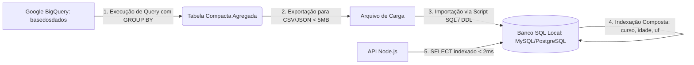
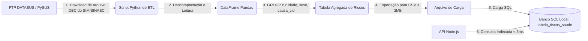
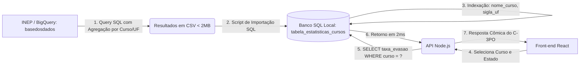
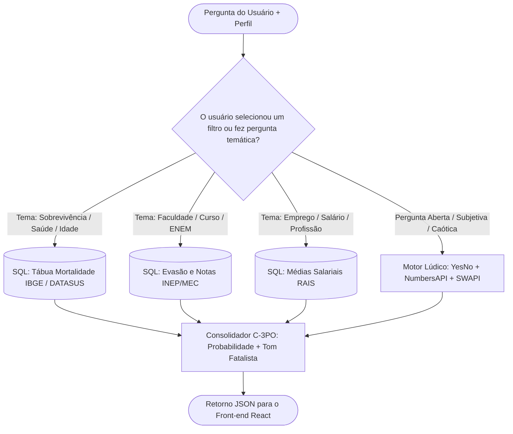
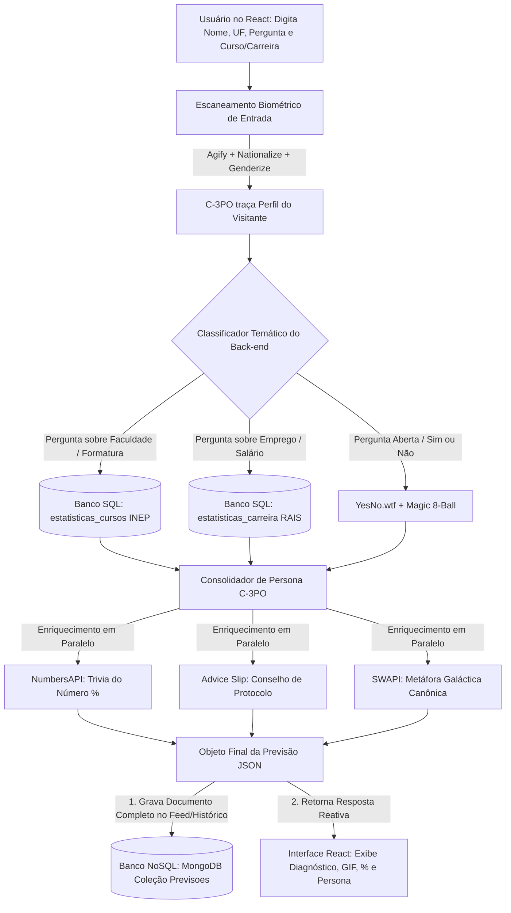

# Especificação Técnica - Vidente.db

## Sumário
1. [Visão Geral do Projeto](#1-visão-geral-do-projeto)
2. [Justificativa e Objetivos](#2-justificativa-e-objetivos)
3. [Arquitetura do Sistema](#3-arquitetura-do-sistema)
4. [Requisitos do Sistema](#4-requisitos-do-sistema)
    - [Requisitos Funcionais (RF)](#requisitos-funcionais-rf)
    - [Requisitos Não Funcionais (RNF)](#requisitos-não-funcionais-rnf)
5. [Regras de Negócio](#5-regras-de-negócio)
6. [Modelagem de Dados (Persistência Poliglota)](#6-modelagem-de-dados-persistência-poliglota)
    - [Banco de Dados Relacional (SQL)](#banco-de-dados-relacional-sql)
    - [Banco de Dados Não Relacional (NoSQL)](#banco-de-dados-não-relacional-nosql)
7. [Tecnologias Utilizadas](#7-tecnologias-utilizadas)
8. [Fontes de Dados e Integração (Oráculo)](#8-fontes-de-dados-e-integração-oráculo)
    - [Visão Geral e Eixos](#81-visão-geral-e-eixos-do-sistema)
    - [Dossiê Completo: Ecossistema do IBGE](#82-dossiê-completo-o-ecossistema-do-ibge)
    - [As 17 APIs Oficiais do Serviço de Dados](#83-análise-das-17-apis-oficiais-do-ibge)
    - [O Universo Dentro da API SIDRA](#84-o-universo-oculto-dentro-da-api-sidra-agregados)
    - [Limitações Técnicas e LGPD](#85-o-que-não-podemos-fazer-limitações-técnicas-e-lgpd)
    - [Tabela de Endpoints e Exemplos Práticos](#86-tabela-de-endpoints-e-exemplos-reais)
    - [Arquitetura Ideal de Integração](#87-arquitetura-ideal-de-integração-para-o-videntedb)
    - [Dossiê Completo: A Base dos Dados](#88-dossiê-completo-a-base-dos-dados-basedosdadosorg)
        - [O que é e Por Que é Revolucionária](#881-o-que-é-a-base-dos-dados-e-por-que-ela-é-revolucionária)
        - [Datasets Estratégicos Mapeados](#882-datasets-e-tabelas-estratégicas-para-o-oráculo)
        - [O que Podemos e Não Podemos Fazer](#883-o-que-podemos-e-não-podemos-fazer-regras-do-bigquery)
        - [Consultas SQL Reais no BigQuery](#884-consultas-sql-reais-no-bigquery-para-o-c-3po)
        - [Pipeline de Extração ETL para o Banco SQL](#885-pipeline-de-extração-etl-para-o-banco-sql-do-projeto)
    - [Dossiê Completo: DATASUS](#89-dossiê-completo-o-datasus-ministério-da-saúde)
        - [O que é e Seu Papel na Saúde Pública](#891-o-que-é-o-datasus-e-seu-papel-na-saúde-pública)
        - [Sistemas Chave: SIM, SINASC, SIH e SINAN](#892-os-grandes-sistemas-clínicos-e-epidemiológicos)
        - [O Desafio Técnico: Formato .DBC vs. PySUS e Parquet](#893-o-desafio-técnico-o-formato-dbc-vs-pysus-e-parquet)
        - [O que Podemos e Não Podemos Fazer](#894-o-que-podemos-e-não-podemos-fazer-lgpd-e-segurança)
        - [Ideias de Previsões para o C-3PO](#895-aplicação-prática-e-humor-estatístico-para-o-c-3po)
        - [Pipeline ETL do DATASUS](#896-pipeline-etl-do-datasus-para-o-banco-sql-do-videntedb)
    - [Dossiê Completo: INEP / MEC](#810-dossiê-completo-o-inep--mec-educação-superior-e-enem)
        - [O que é o INEP e a Radiografia Educacional](#8101-o-que-é-o-inep-e-seu-papel-na-educação-brasileira)
        - [Grandes Bases: Censo Superior, ENEM e Censo Escolar](#8102-as-grandes-bases-de-dados-educacionais)
        - [Métricas e Variáveis Críticas para o Oráculo](#8103-métricas-e-variáveis-chave-para-o-oráculo)
        - [O que Podemos e Não Podemos Fazer](#8104-o-que-podemos-e-não-podemos-fazer-lgpd-e-big-data)
        - [Ideias de Previsões e Humor Acadêmico para o C-3PO](#8105-aplicação-prática-e-humor-acadêmico-para-o-c-3po)
        - [Pipeline ETL do INEP para o Vidente.db](#8106-pipeline-etl-do-inep-para-o-banco-sql-do-videntedb)
    - [Dossiê Completo: APIs Lúdicas e de Humor](#811-dossiê-completo-apis-lúdicas-e-de-humor-a-inteligência-do-caos)
        - [O Papel do Humor e Fallback no Oráculo](#8111-o-papel-das-apis-lúdicas-no-videntedb)
        - [Mapeamento das Principais APIs Lúdicas](#8112-mapeamento-das-principais-apis-lúdicas)
        - [Tabela de Endpoints e Retornos JSON](#8113-tabela-de-endpoints-e-formatos-de-retorno)
        - [Matriz de Decisão: Banco Governamental vs. API Lúdica](#8114-matriz-de-decisão-banco-governamental-vs-api-lúdica)
        - [Arquitetura de Resiliência e Fallback](#8115-arquitetura-de-resiliência-e-fallback)
9. [Seleção Oficial de Fontes de Dados (Escopo de Implementação)](#9-seleção-oficial-de-fontes-de-dados-escopo-de-implementação)
    - [Justificativa do Recorte Estratégico](#91-justificativa-do-recorte-estratégico)
    - [Fontes Governamentais Selecionadas (Camada SQL)](#92-fontes-governamentais-selecionadas-camada-sql)
    - [APIs Lúdicas e de Humor Selecionadas (Camada Web II)](#93-apis-lúdicas-e-de-humor-selecionadas-camada-web-ii)
    - [Fluxo Integrado da Experiência e Persona C-3PO](#94-fluxo-integrado-da-experiência-e-persona-c-3po)
    - [Estratégia de Performance, Cache e Mitigação de Rate-Limit](#95-estratégia-de-performance-cache-e-mitigação-de-rate-limit)

---

## 1. Visão Geral do Projeto
O **Vidente.db** é um sistema web interativo com temática humorística voltada ao universo de tecnologia/nerd. O personagem central, inspirado no droide C-3PO de Star Wars, atua como um "oráculo" calculista e fatalista, fornecendo probabilidades dramáticas para perguntas feitas pelos usuários. O sistema será construído integrando conceitos de desenvolvimento web moderno (Web II) e persistência de dados híbrida (BD II).

## 2. Justificativa e Objetivos
Este projeto tem como principal objetivo acadêmico aplicar na prática os conceitos estudados nas disciplinas de **Web II** e **Banco de Dados II**.
A obrigatoriedade de adotar uma arquitetura de **persistência poliglota** justifica-se pela necessidade técnica de compreender e implementar múltiplos paradigmas de banco de dados (Relacional e Não Relacional) dentro do mesmo ecossistema, utilizando a ferramenta mais adequada para cada tipo de carga de trabalho e modelagem.

## 3. Arquitetura do Sistema
O sistema adota o modelo Cliente-Servidor baseado em API REST:
- **Client-side (Front-end):** Interface desenvolvida em React.js utilizando **TypeScript** (Single Page Application). É a camada encarregada de coletar as perguntas do usuário, exibir as animações do "Oráculo" e renderizar de forma reativa os retornos do sistema.
- **Server-side (Back-end):** API estruturada em Node.js com Express utilizando **JavaScript**, atuando como o elo de lógica de negócio e interfaceamento com a camada de persistência.
- **Database Layer:** Camada dividida estrategicamente entre um Sistema de Gerenciamento de Banco de Dados Relacional (SGBD) e um banco de dados NoSQL Orientado a Documentos.

## 4. Requisitos do Sistema

### Requisitos Funcionais (RF)
*(Ações e comportamentos que o sistema deve obrigatoriamente executar)*
- **RF01:** O sistema deve permitir que um usuário crie uma conta fornecendo Nome, E-mail e Senha.
- **RF02:** O sistema deve permitir a autenticação do usuário.
- **RF03:** O usuário poderá enviar uma pergunta em formato de texto livre para o Oráculo.
- **RF04:** O sistema deverá processar a requisição e retornar uma probabilidade (%) calculada e uma mensagem de resposta baseada no estilo do personagem.
- **RF05:** O sistema deve registrar e salvar um histórico das interações (perguntas, previsões e datas).
- **RF06:** O sistema deve expor um *feed* (lista pública ou privada) com as consultas recentes feitas ao Oráculo.
- **RF07:** O sistema deve permitir login e cadastro simplificado utilizando contas do Google (OAuth2).

### Requisitos Não Funcionais (RNF)
*(Restrições técnicas, performance, usabilidade e qualidade)*
- **RNF01:** A interface de usuário deve ser construída exclusivamente com a biblioteca React.js e padronizada com **TypeScript**.
- **RNF02:** O backend deve ser uma API RESTful escrita em **JavaScript**, utilizando Node.js e Express.
- **RNF03:** O armazenamento de dados deve ser híbrido (Poliglota), integrando um banco de dados relacional e um não relacional simultaneamente.
- **RNF04:** O sistema deve manter as senhas dos usuários criptografadas no banco (utilizando *hashes* como o bcrypt).

## 5. Regras de Negócio
- **RN01:** Não será permitido o cadastro de dois usuários com o mesmo endereço de e-mail.
- **RN02:** Toda previsão retornada pelo oráculo deverá conter uma taxa de probabilidade gerada de forma lógica e arbitrária variando entre 0% e 100%.
- **RN03:** O "tom" da mensagem retornada ao usuário deverá variar dependendo da faixa da probabilidade (Ex: Se probabilidade < 15%, a mensagem deverá ser excessivamente dramática e pessimista).

## 6. Modelagem de Dados (Persistência Poliglota)

### Banco de Dados Relacional (SQL)
Responsável por dados altamente estruturados e relacionamentos estáveis (Ex: Dados administrativos).
- **Entidades Foco:** `Usuarios`
- **Por que SQL?** Porque entidades de usuários exigem um esquema rígido (colunas fixas: id, nome, email, senha), integridade referencial forte e propriedades ACID para garantir que não haja duplicação ou anomalias nos logins.

### Banco de Dados Não Relacional (NoSQL)
Responsável pelo registro de alto volume e esquema flexível (Ex: Feed e Histórico).
- **Coleções Foco:** `Previsoes` (contendo o id do usuário associado, a pergunta, a probabilidade calculada e as palavras do oráculo).
- **Por que NoSQL?** As previsões podem ser consideradas *documentos*. O esquema não precisa ser engessado, facilitando a adição de novos metadados (como "humor do oráculo" ou "tempo de resposta") no futuro sem quebrar tabelas existentes. E possibilita altíssima velocidade para a leitura do "feed" na página inicial.

## 7. Tecnologias Utilizadas
- **Front-end:** React.js, TypeScript, HTML5, CSS3.
- **Back-end:** Node.js, Express, JavaScript.
- **Bancos de Dados:** PostgreSQL ou MySQL (SQL) + MongoDB (NoSQL).
- **Outros:** Git e GitHub (Versionamento).

## 8. Fontes de Dados e Integração (Oráculo)

Para gerar previsões estatisticamente reais (exibidas com o tom dramático e pessimista do C-3PO), o sistema integrará bases públicas e dados abertos do Brasil através de uma arquitetura híbrida de consumo direto e **ETL (Extract, Transform, Load)**.

### 8.1. Visão Geral e Eixos do Sistema
1. **Saúde e Longevidade:** Tábuas de sobrevivência, expectativa de vida e histórico demográfico de mortalidade.
2. **Carreira, Trabalho e Renda:** Indicadores de ocupação, renda média por profissão e evasão estudantil.
3. **Comportamento e Sociedade:** Casamentos, divórcios, hábitos de consumo e acesso a tecnologia.
4. **Caos Aleatório (Fallback):** Respostas lúdicas para perguntas não determinísticas geradas por APIs utilitárias (`Agify.io`, `YesNo API`).

---

### 8.2. Dossiê Completo: O Ecossistema do IBGE
O Instituto Brasileiro de Geografia e Estatística disponibiliza o **Serviço de Dados do IBGE** (`servicodados.ibge.gov.br`), um catálogo público de APIs REST gratuitas, abertas, com resposta nativa em formato `JSON` e que **dispensam chave de autenticação ou cadastro prévio**.

---

### 8.3. Análise das 17 APIs Oficiais do IBGE

Abaixo estão detalhados todos os 17 serviços oficiais disponibilizados no catálogo de dados abertos do instituto:

1. **API de Agregados (SIDRA - `/api/v3/agregados`):**
   - *Finalidade:* Acesso ao banco do Sistema IBGE de Recuperação Automática. Centraliza dados tabulares de censos e pesquisas econômicas e sociais.
   - *Aplicação no C-3PO:* Cálculo de cruzamentos avançados de renda, desemprego e saúde.
2. **API de Nomes (`/api/v2/censos/nomes`):**
   - *Finalidade:* Estatísticas de frequência, popularidade histórica por década (desde 1930) e ranking por sexo e UF a partir do Censo Demográfico.
   - *Aplicação no C-3PO:* O oráculo analisa o nome do usuário e calcula a raridade dele na população galáctica brasileira.
3. **API de Projeções Populacionais (`/api/v1/projecoes`):**
   - *Finalidade:* Projeções matemáticas da população brasileira e estadual em tempo real, além do relógio de frequência (intervalo em segundos de nascimentos e mortes).
   - *Aplicação no C-3PO:* Renderização de relógio cósmico na tela: *"Desde que você abriu esta página, 3 cidadãos nasceram e 2 faleceram no Brasil"*.
4. **API de Localidades (`/api/v1/localidades`):**
   - *Finalidade:* Lista hierárquica oficial de divisões político-administrativas (Regiões, Estados, Mesorregiões, Microrregiões e Municípios com códigos IBGE).
   - *Aplicação no C-3PO:* Alimentação dos campos de formulário dinâmicos no front-end React.
5. **API de Malhas Geográficas (`/api/v3/malhas`):**
   - *Finalidade:* Extração de polígonos e limites territoriais nos formatos vetoriais `SVG`, `GeoJSON` e `TopoJSON`.
   - *Aplicação no C-3PO:* Exibição de mapa interativo no React, destacando o estado do usuário com efeitos de alerta.
6. **API de Países (`/api/v1/paises`):**
   - *Finalidade:* Indicadores sociais, demográficos, econômicos e ambientais consolidados de mais de 190 nações do mundo.
   - *Aplicação no C-3PO:* Comparações internacionais dramáticas: *"A sua probabilidade de sobrevivência seria 22% maior se residisse na Islândia, senhor!"*.
7. **API do CNAE (`/api/v2/cnae`):**
   - *Finalidade:* Classificação Nacional de Atividades Econômicas (Seções, Divisões, Grupos e Classes).
   - *Aplicação no C-3PO:* Classificação formal do setor de trabalho do usuário para cálculos de riscos ocupacionais.
8. **API de Notícias (`/api/v3/noticias`):**
   - *Finalidade:* Consulta aos releases, notícias institucionais e editorias publicadas pela agência IBGE.
   - *Aplicação no C-3PO:* Noticiário estelar ao vivo de dados do Brasil integrado ao feed do site.
9. **API de Calendário (`/api/v3/calendario`):**
   - *Finalidade:* Cronograma oficial de divulgação de índices (IPCA, PIB, PNAD).
   - *Aplicação no C-3PO:* Previsões de datas futuras onde novos dados trarão "más ou boas notícias".
10. **API de Pesquisas (`/api/v1/pesquisas`):**
    - *Finalidade:* Metadados, notas metodológicas e histórico de todas as operações estatísticas do instituto.
11. **API de Produtos (`/api/v1/produtos`):**
    - *Finalidade:* Catálogo de softwares, tabelas, dados vetoriais e publicações geradas pelo instituto.
12. **API de Publicações (`/api/v1/publicacoes`):**
    - *Finalidade:* Consulta bibliográfica e relatórios técnicos do IBGE em formato digital.
13. **API de Metadados (`/api/v1/metadados`):**
    - *Finalidade:* Dicionário oficial de conceitos, variáveis e classificações estatísticas.
14. **API de Banco de Dados Geodésicos - BDG (`/api/v1/bdg`):**
    - *Finalidade:* Estações geodésicas, marcos altimétricos e dados de nivelamento do território nacional.
15. **API ProGriD (`/api/v1/progrid`):**
    - *Finalidade:* Transformação técnica de coordenadas entre referenciais geodésicos (SAD69, Córrego Alegre, SIRGAS2000).
16. **API de Posicionamento por Ponto Preciso - PPP (`/api/v1/ppp`):**
    - *Finalidade:* Pós-processamento de dados GNSS para precisão centimétrica de receptores de satélite.
17. **API RBMC (`/api/v1/rbmc`):**
    - *Finalidade:* Rede Brasileira de Monitoramento Contínuo dos Sistemas GNSS (dados de rastreio de satélites).

*(Nota: Os serviços 14 a 17 são de natureza estritamente geodésica e cartográfica especializada, não sendo o foco principal de inferência probabilística do oráculo, mas compõem o catálogo completo oficial).*

---

### 8.4. O Universo Oculto Dentro da API SIDRA (Agregados)

A API de Agregados (`/api/v3/agregados`) é um repositório gigantesco que contém dezenas de pesquisas sociológicas e econômicas essenciais para o nosso gerador de probabilidades:

* **Estatísticas do Registro Civil:**
  * Dados anuais de casamentos civis, uniões e divórcios por faixas de idade dos cônjuges e estado.
  * *Uso no C-3PO:* Predição de riscos matrimoniais e probabilidade de divórcio em $N$ anos.
* **Pesquisa de Orçamentos Familiares (POF):**
  * Padrão de consumo das famílias: percentual de gastos com moradia, alimentação, remédios, entretenimento, eletrônicos e endividamento.
  * *Uso no C-3PO:* Cálculo da probabilidade de o usuário terminar o mês com dívidas ou gastar mais com delivery do que com investimentos.
* **Pesquisa Nacional de Saúde (PNS):**
  * Proporção de indivíduos com doenças crônicas, sedentarismo, obesidade, consumo de álcool/tabaco e diagnóstico de depressão por UF.
  * *Uso no C-3PO:* Inferência de riscos de saúde e hábitos com tom irônico de manutenção de droides.
* **PNAD Contínua (Pesquisa Nacional por Amostra de Domicílios Contínua):**
  * Séries temporais de taxa de desocupação (desemprego), informalidade e rendimento médio real domiciliar *per capita*.
  * *Uso no C-3PO:* Probabilidade de sucesso no mercado de trabalho e média de tempo para colocação profissional.
* **Censo Agropecuário:**
  * Informações de rebanhos (bovino, suíno, aves) e colheitas agrícolas.
  * *Uso no C-3PO:* Geração de dados de humor regional (ex: número de bovinos *versus* seres humanos por metro quadrado na região do usuário).
* **Índices de Preços ao Consumidor (IPCA / INPC):**
  * Acompanhamento oficial da inflação e perda do poder de compra no Brasil.

---

### 8.5. O que NÃO Podemos Fazer (Limitações Técnicas e LGPD)

1. **Apenas Operações de Leitura (`GET`):** Todas as APIs do IBGE são estritamente de consulta pública. Não é possível enviar cadastros ou modificar dados.
2. **Limite de Células no SIDRA (50.000 a 100.000 células):** Consultas muito amplas (ex: "todas as variáveis de todas as cidades de todos os anos") geram estouro de memória, truncamento ou erro de *HTTP 400/500*.
3. **Sem Garantia de SLA / Risco de Timeout (`HTTP 504`):** Os servidores federais sofrem picos de instabilidade. A dependência síncrona do IBGE em tempo de execução causaria lentidão inaceitável para o usuário final.
4. **Anonimização Estrita (LGPD e Lei do Sigilo Estatístico nº 5.534/1968):** O IBGE **nunca** disponibiliza dados nominais ou microdados individuais por API. A granularidade mínima é municipal ou por faixa amostral.
5. **Tábuas de Mortalidade Fora do SIDRA Dinâmico:** As Tábuas Completas de Mortalidade são divulgadas como relatórios de projeção anual (planilhas consolidadas), não como rota dinâmica no SIDRA, exigindo importação prévia (ETL).

---

### 8.6. Tabela de Endpoints e Exemplos Reais

| Finalidade | Método | Endpoint Oficial | Retorno Esperado |
| :--- | :---: | :--- | :--- |
| **Frequência de Nome** | `GET` | `https://servicodados.ibge.gov.br/api/v2/censos/nomes/{nome}` | Array JSON com décadas e total de ocorrências. |
| **Ranking Nacional de Nomes** | `GET` | `https://servicodados.ibge.gov.br/api/v2/censos/nomes/ranking` | JSON com os 20 nomes mais registrados no Brasil. |
| **Projeção Populacional** | `GET` | `https://servicodados.ibge.gov.br/api/v1/projecoes/populacao` | Estimativa atualizada ao segundo e taxas de nascimento/óbito. |
| **Lista de UFs (Estados)** | `GET` | `https://servicodados.ibge.gov.br/api/v1/localidades/estados` | Lista com `id`, `sigla` e `nome` das 27 UFs. |
| **Municípios de uma UF** | `GET` | `https://servicodados.ibge.gov.br/api/v1/localidades/estados/{UF}/municipios` | Lista de municípios do estado especificado. |
| **Malha Vetorial de um Estado** | `GET` | `https://servicodados.ibge.gov.br/api/v3/malhas/estados/{UF}?formato=application/vnd.geo+json` | Polígonos em GeoJSON para renderização de mapa. |
| **Indicadores de Países** | `GET` | `https://servicodados.ibge.gov.br/api/v1/paises/{pais}` | Indicadores econômicos e sociais do país solicitado. |
| **Consulta SIDRA (Exemplo)** | `GET` | `https://servicodados.ibge.gov.br/api/v3/agregados/{agregado}/periodos/{p}/variaveis/{v}?localidades={n}` | Matriz estruturada de dados agregados. |

---

### 8.7. Arquitetura Ideal de Integração para o Vidente.db

A persistência e a lógica do sistema serão organizadas em três camadas complementares para garantir velocidade e confiabilidade:


* **Consumo Imediato no Front-end (Client-Side):**
  * O React consome diretamente as APIs leves (`Localidades`, `Nomes` e `Projeções Populacionais`) para fornecer formulários dinâmicos e enriquecimento de tela sem sobrecarregar o back-end.
* **Camada de Carga Prévia (ETL no Banco SQL):**
  * Dados analíticos pesados (Tábua de Mortalidade, Renda da PNAD, Estatísticas do Registro Civil) são extraídos previamente, normalizados e indexados no banco relacional (MySQL/PostgreSQL).
  * O Node.js consulta o banco local com índices compostos `(uf, faixa_etaria, sexo)`, respondendo em menos de 5 milissegundos.
* **Camada de Auditoria e Flexibilidade (Banco NoSQL):**
  * Cada previsão gerada pelo C-3PO é persistida no MongoDB contendo o ID do usuário, a pergunta feita, os parâmetros demográficos utilizados e a resposta gerada com suas probabilidades.

---

### 8.8. Dossiê Completo: A Base dos Dados (basedosdados.org)

Enquanto as APIs do IBGE atendem a consultas demográficas e imediatas, a **Base dos Dados (BD)** é a ferramenta analítica mais poderosa do projeto. Ela atua como um imenso *Data Lakehouse* público e aberto, centralizando, tratando e interconectando dados de múltiplos ministérios e entidades governamentais.

---

#### 8.8.1. O que é a Base dos Dados e Por Que Ela é Revolucionária?
Trabalhar com dados públicos brutos no Brasil normalmente é um processo penoso: arquivos massivos em `.csv` ou `.dbc` corrompidos, *encodings* legados (como ISO-8859-1), falta de chaves primárias padronizadas e dicionários que mudam de ano para ano.

A **Base dos Dados** resolve isso ao:
1. **Padronizar Chaves e Nomes:** Todos os municípios seguem o código IBGE de 7 dígitos, nomes de colunas são harmonizados em `snake_case`, e datas adotam o padrão ISO-8601 (`YYYY-MM-DD`).
2. **Hospedagem no Google BigQuery:** Os dados residem no projeto público `basedosdados` no BigQuery, permitindo realizar consultas analíticas de alta performance via **SQL ANSI** em bases de dezenas de milhões de linhas em segundos.
3. **Cruzamento entre Ministérios:** Permite realizar um `JOIN` direto entre uma tabela do Ministério da Educação (MEC/INEP) e uma do Ministério da Economia/Trabalho (RAIS) sem precisar baixar um único arquivo para a máquina local.

---

#### 8.8.2. Datasets e Tabelas Estratégicas para o Oráculo

Abaixo estão os conjuntos de dados (*datasets*) e tabelas mais valiosos para o **Vidente.db**:

| Órgão / Tema | Dataset no BigQuery | Tabelas Chave | Variáveis de Interesse para o C-3PO |
| :--- | :--- | :--- | :--- |
| **Ministério do Trabalho (RAIS)** | `basedosdados.br_me_rais` | `microdados_vinculos`, `microdados_estabelecimentos` | `valor_remuneracao_media`, `idade`, `sexo`, `cbo_2002` (ocupação), `grau_instrucao_1985_2005`, `tempo_emprego`, `sigla_uf` |
| **INEP / MEC (Censo Superior)** | `basedosdados.br_inep_censo_educacao_superior` | `curso` | `nome_curso`, `grau_academico`, `qt_matricula_curso`, `qt_concluinte_curso`, `qt_desvinculado_curso` (evasão) |
| **Ministério da Saúde (DATASUS / SIM)** | `basedosdados.br_ms_sim` | `microdados` | `causa_basica` (código CID-10), `idade`, `sexo`, `sigla_uf`, `local_ocorrencia` |
| **Receita Federal (CNPJ)** | `basedosdados.br_receita_federal_cnpj` | `estabelecimentos`, `empresas` | `situacao_cadastral` (Ativa/Baixada), `motivo_situacao_cadastral`, `cnae_fiscal_principal`, `data_inicio_atividade` |

##### Casos de Aplicação nas Previsões do C-3PO:
1. **O Pesadelo da Formatura (INEP):**
   > *"Senhor, de acordo com o Censo da Educação Superior, a probabilidade de um aluno de Ciência da Computação evadir antes da conclusão é de alarmantes 54,2%! As chances de você receber seu diploma no prazo regular são de apenas 1 em 3!"*
2. **O Abismo Salarial e Emprego (RAIS):**
   > *"Com base nos microdados da RAIS no estado de Minas Gerais, a probabilidade de uma pessoa na sua faixa etária e ocupação atingir mais de 5 salários mínimos é de míseros 8,7%. Sugiro economizar seus créditos galácticos!"*
3. **A Aventura Empresarial (Receita Federal):**
   > *"Caso esteja pensando em abrir uma empresa nesse setor, os dados da Receita Federal indicam que 48% dos estabelecimentos encerram suas atividades nos primeiros 3 anos. Um risco inaceitável para circuitos sensíveis!"*

---

#### 8.8.3. O que Podemos e Não Podemos Fazer (Regras do BigQuery)

##### O que PODEMOS Fazer:
* **1 Terabyte (1 TB) Gratuito por Mês:** O Google Cloud Platform oferece 1 TB de processamento de dados sem custos por mês via BigQuery (mesmo em modo *Sandbox*, sem necessidade de cartão de crédito cadastrado).
* **Consultas SQL Completas e Agregações Complexas:** Uso de funções de agregação (`AVG`, `COUNT`, `PERCENTILE_CONT`), janelas analíticas (`OVER (PARTITION BY ...)`), e `JOINs` entre órgãos distintos.
* **Automação via Script (Python / Node):** Uso do pacote oficial `basedosdados` em Python (`pip install basedosdados`) ou das bibliotecas de cliente `@google-cloud/bigquery` em Node.js para rodar queries e exportar resultados.

##### O que NÃO PODEMOS Fazer (Limitações Críticas):
1. **Proibido Consultar o BigQuery em Tempo de Execução (On-the-Fly):** 
   * Cada consulta no BigQuery tem uma latência de processamento OLAP (entre 2 a 6 segundos). Fazer o usuário esperar esse tempo na interface React tornaria o sistema lento.
   * Executar uma consulta a cada clique esgotaria a cota gratuita de 1 TB rapidamente se vários usuários acessassem o site.
2. **Proibido Utilizar `SELECT *`:**
   * A tabela `microdados_vinculos` da RAIS possui centenas de milhões de linhas e dezenas de gigabytes. Um simples `SELECT *` pode consumir centenas de Gigabytes da cota mensal em um único segundo.
   * **Regra obrigatória:** Selecionar estritamente as colunas necessárias e filtrar sempre por partições (ex: `WHERE ano = 2023 AND sigla_uf = 'SP'`).
3. **Não Serve como Banco da Aplicação:** O BigQuery é um banco colunar analítico (OLAP), não suportando operações transacionais de alta frequência (leituras de milissegundos e escritas unitárias rápidas para usuários do sistema).

---

#### 8.8.4. Consultas SQL Reais no BigQuery para o C-3PO

Abaixo estão dois exemplos de queries SQL otimizadas prontas para extrair matrizes de probabilidade no BigQuery:

##### Exemplo 1: Probabilidade de Evasão Universitária por Curso (INEP)
```sql
SELECT
  sigla_uf,
  nome_curso,
  SUM(qt_matricula_curso) AS total_matriculas,
  SUM(qt_concluinte_curso) AS total_concluintes,
  SUM(qt_desvinculado_curso) AS total_evadidos,
  -- Cálculo da Taxa de Evasão (%)
  ROUND(SAFE_DIVIDE(SUM(qt_desvinculado_curso), SUM(qt_matricula_curso)) * 100, 2) AS taxa_evasao_percentual
FROM `basedosdados.br_inep_censo_educacao_superior.curso`
WHERE ano = 2023
GROUP BY sigla_uf, nome_curso
HAVING total_matriculas > 100
ORDER BY taxa_evasao_percentual DESC;
```

##### Exemplo 2: Salário Médio e Distribuição por Idade e Ocupação (RAIS)
```sql
SELECT
  sigla_uf,
  faixa_etaria,
  cbo_2002,
  COUNT(1) AS total_trabalhadores,
  ROUND(AVG(valor_remuneracao_media), 2) AS salario_medio,
  -- Percentual de trabalhadores que ganham acima de R$ 5.000
  ROUND(COUNTIF(valor_remuneracao_media > 5000) / COUNT(1) * 100, 2) AS probabilidade_ganhar_acima_5k
FROM `basedosdados.br_me_rais.microdados_vinculos`
WHERE ano = 2023 AND sigla_uf IN ('SP', 'RJ', 'MG', 'RS')
GROUP BY sigla_uf, faixa_etaria, cbo_2002
HAVING total_trabalhadores >= 50;
```

---

#### 8.8.5. Pipeline de Extração ETL para o Banco SQL do Projeto

Para integrar todo esse poder com o **Vidente.db**, adotaremos o seguinte fluxo de engenharia de dados:



1. **Extração e Agregação (BigQuery):** Rodamos as consultas acima para calcular as taxas de evasão e médias salariais agrupadas por `(sigla_uf, nome_curso)` e `(sigla_uf, faixa_etaria, cbo_2002)`.
2. **Compactação:** A base de milhões de linhas transforma-se em uma tabela enxuta de probabilidades com menos de 20.000 linhas (~2 a 5 MB).
3. **Carga no SQL Local:** Criamos tabelas como `estatisticas_cursos` e `estatisticas_carreira` no nosso banco relacional local.
4. **Performance Absoluta:** O C-3PO consulta os dados instantaneamente em milissegundos sem custos de API e com resiliência total contra falhas de internet.

---

### 8.9. Dossiê Completo: O DATASUS (Ministério da Saúde)

O **DATASUS** (Departamento de Informática do Sistema Único de Saúde) é o repositório responsável por gerenciar e disseminar as informações do maior sistema público de saúde do planeta. Para o **Vidente.db**, o DATASUS representa a fonte suprema para previsões hipocondríacas, riscos biológicos e estatísticas vitais com o clássico desespero do C-3PO.

---

#### 8.9.1. O que é o DATASUS e Seu Papel na Saúde Pública?
Criado em 1991, o DATASUS consolida os registros administrativos, ambulatoriais, epidemiológicos e hospitalares gerados por milhares de hospitais, postos de saúde (UBS) e cartórios do país. 

Ele é uma estrutura descentralizada: as secretarias municipais e estaduais de saúde alimentam os sistemas locais, que transmitem as bases para o governo federal consolidar.

---

#### 8.9.2. Os Grandes Sistemas Clínicos e Epidemiológicos

O ecossistema do DATASUS é fragmentado em múltiplos subsistemas históricos especializados:

| Sistema | Significado | O que Registra | Variáveis Mais Ricas para o Oráculo |
| :--- | :--- | :--- | :--- |
| **SIM** | Sistema de Informações sobre Mortalidade | Todas as Declarações de Óbito (DO) do país | `causa_basica` (Código CID-10), `idade`, `sexo`, `estado_civil`, `ocupacao`, `local_ocorrencia` (hospital, domicílio, via pública) |
| **SINASC** | Sistema de Informações sobre Nascidos Vivos | Todas as Declarações de Nascido Vivo (DN) | `peso_nascer`, `semanas_gestacao`, `tipo_parto` (normal vs. cesárea), `tipo_gravidez` (única, dupla, tripla), `apgar1`, `apgar5`, `idade_mae` |
| **SIH/SUS** | Sistema de Informações Hospitalares | Todas as internações financiadas pelo SUS (AIH) | `diagnostico_principal` (CID-10), `procedimento_realizado`, `dias_permanencia`, `valor_total`, `carater_atendimento` (urgência vs. eletivo) |
| **SINAN** | Sistema de Informação de Agravos de Notificação | Doenças infecciosas e agravos compulsórios | Casos notificados de Dengue, Chikungunya, Tuberculose, picadas de **animais peçonhentos** (escorpiões, serpentes, aranhas), intoxicações |
| **SISVAN** | Sistema de Vigilância Alimentar e Nutricional | Estado nutricional da população atendida no SUS | Índice de Massa Corporal (IMC), taxas de obesidade, desnutrição e consumo de alimentos ultraprocessados por município |

---

#### 8.9.3. O Desafio Técnico: O Formato `.DBC` vs. PySUS e Parquet

Trabalhar diretamente com o DATASUS costuma ser uma "pedra no sapato" de engenheiros iniciantes devido a uma particularidade técnica histórica:

1. **O Formato Arcaico `.DBC`:**
   * Nos anos 1990, para economizar espaço de armazenamento e banda de internet discada, o DATASUS criou um formato proprietário comprimido chamado `.DBC` (uma compactação dos antigos arquivos `.DBF` do dBase III/FoxPro usando o algoritmo PKWARE Blast).
   * **Problema:** Nenhuma biblioteca padrão de JavaScript, Python ou banco de dados moderno consegue abrir um arquivo `.DBC` diretamente.
2. **A Solução Moderna: `PySUS` (Python):**
   * Mantido pelo Programa de Computação Científica da Fiocruz (PROCC), a biblioteca **PySUS** resolve todo esse pesadelo:
     ```bash
     pip install pysus
     ```
   * O PySUS baixa os dados brutos via FTP do DATASUS, descompacta os arquivos `.dbc` em memória e os converte instantaneamente para tabelas **Apache Parquet** ou DataFrames do Pandas.
3. **Portal de Dados Abertos do SUS (API CKAN):**
   * Disponível em `dadosabertos.saude.gov.br`, possui API REST baseada no padrão CKAN (`/api/3/action/package_show?id=sim`), fornecendo metadados e links diretos para downloads em `.csv` e `.json` modernos.
4. **O Atalho da Base dos Dados:**
   * Como documentado na seção anterior, a equipe da *basedosdados.org* já realizou o trabalho sujo de descompactar e tratar o SIM (`basedosdados.br_ms_sim.microdados`) diretamente no BigQuery.

---

#### 8.9.4. O que Podemos e Não Podemos Fazer (LGPD e Segurança)

##### O que NÃO PODEMOS Fazer:
* **Proibido Tentar Acessar Dados Nominais:** Sob hipótese alguma o DATASUS expõe nomes de pacientes, CPFs ou endereços residenciais. A LGPD e a Resolução CFM nº 1.638/2002 impõem sigilo absoluto. Os microdados públicos são 100% anonimizados.
* **Sem API REST Síncrona Oficial para o SIM/SINASC:** Não existe um endpoint público do Ministério da Saúde como `GET /api/risco-morte?idade=30`. Toda tentativa de consumir o DATASUS ao vivo em tempo de requisição web falhará.
* **Sistemas Operacionais Restritos:** Os ambientes de produção do SUS (e-SUS, SISAB) exigem certificados digitais ICP-Brasil e credenciamento de IP de prefeituras/hospitais.

##### O que PODEMOS Fazer:
* **Download Ilimitado e Gratuito dos Microdados Anualizados:** Arquivos abertos hospedados no FTP oficial (`ftp://ftp.datasus.gov.br/dissemin/publicos/`).
* **Cruzamento Estatístico por CID-10:** Identificar a probabilidade de as principais causas de morte ou internação ocorrerem em determinada faixa de idade ou região.
* **Geração de Matrizes de Risco Relativo:** Calcular, por exemplo, qual a probabilidade de uma gestação resultar em gêmeos (SINASC) ou a incidência de acidentes com animais peçonhentos no estado do usuário (SINAN).

---

#### 8.9.5. Aplicação Prática e Humor Estatístico para o C-3PO

Com os dados do DATASUS agregados, as respostas do C-3PO tornam-se incrivelmente precisas e divertidas:

1. **A Hipocondria dos Riscos (SIM - Mortalidade):**
   > *"Senhor, aos 24 anos no estado do Rio de Janeiro, a probabilidade estatística de você falecer por causas cardiovasculares este ano é de apenas 0,02%. No entanto, acidentes de trânsito e causas externas representam 68% dos riscos para a sua idade! Eu fortemente sugiro que o senhor permaneça trancado em sua câmara criogênica!"*
2. **A Adivinhação de Gêmeos (SINASC - Nascidos Vivos):**
   > *"Calculando com base no SINASC: para uma gravidez na sua faixa etária, a probabilidade matemática de ter gêmeos é de 1 em 92 (1,08%). Caso sejam trigêmeos, a chance cai para 1 em 8.500. Seus recursos financeiros certamente não suportariam tamanha anomalia!"*
3. **O Perigo Oculto na Natureza (SINAN - Animais Peçonhentos):**
   > *"Consultando o SINAN no estado de Minas Gerais: foram registrados mais de 30.000 acidentes com escorpiões no último período. Suas chances de encontrar uma criatura venenosa são 14 vezes maiores do que ser atingido por um raio. Cuidado onde pisa, senhor!"*

---

#### 8.9.6. Pipeline ETL do DATASUS para o Banco SQL do Vidente.db

O fluxo técnico para incorporar o DATASUS à nossa aplicação seguirá a engenharia abaixo:



1. **Extração Local Única:** Um script Python simples de 15 linhas usando `pysus` baixa os dados do SIM ou SINASC do último ano disponível.
2. **Transformação e Agregação:** O script agrupa as causas mais frequentes por `(faixa_etaria, sexo, sigla_uf)`, calculando a porcentagem de incidência.
3. **Carga no SQL:** A tabela resultante (`estatisticas_saude`) é importada no nosso banco relacional local, com colunas:
   * `id`, `sigla_uf`, `faixa_etaria`, `sexo`, `causa_predominante`, `percentual_risco`.
4. **Consulta pelo Node.js:** Quando o usuário informa sua idade e estado na interface React, a consulta SQL roda instantaneamente e entrega a previsão ao oráculo sem nenhuma dependência externa ativa.

---

### 8.10. Dossiê Completo: O INEP / MEC (Educação Superior e ENEM)

O **INEP** (Instituto Nacional de Estudos e Pesquisas Educacionais Anísio Teixeira) é a autarquia federal vinculada ao Ministério da Educação (MEC) encarregada de avaliar, auditar e mapear todo o sistema de ensino brasileiro. Para o **Vidente.db**, o INEP fornece o combustível perfeito para prever o sucesso acadêmico, o drama da evasão universitária, o tempo de formatura e o desempenho no vestibular.

---

#### 8.10.1. O que é o INEP e Seu Papel na Educação Brasileira?
Fundado em 1937, o INEP é o guardião das maiores bases de dados educacionais da América Latina. Ele realiza anualmente a radiografia de milhões de estudantes, desde a alfabetização nas escolas públicas e privadas até a pós-graduação, mensurando taxas de rendimento, infraestrutura escolar, evasão e proficiência.

---

#### 8.10.2. As Grandes Bases de Dados Educacionais

O acervo do INEP divide-se em quatro pilares fundamentais de dados abertos:

| Base de Dados | Escopo e Periodicidade | O que Registra | Variáveis Mais Ricas para o Oráculo |
| :--- | :--- | :--- | :--- |
| **Censo da Educação Superior** | Anual (todas as faculdades e universidades do país) | Dados de cursos, instituições e matrículas | `nome_curso`, `grau_academico` (Bacharelado/Licenciatura/Tecnólogo), `co_modalidade` (Presencial vs EAD), `qt_matricula`, `qt_concluinte`, `qt_desvinculado` (evasão), `qt_trancado` |
| **Microdados do ENEM** | Anual (~3 a 5 milhões de participantes por edição) | Desempenho individual nas 5 áreas do conhecimento e questionário de perfil | `NU_NOTA_CN`, `NU_NOTA_CH`, `NU_NOTA_LC`, `NU_NOTA_MT`, `NU_NOTA_REDACAO`, `TP_PRESENCA_*` (abstenção), questionário socioeconômico (renda, computadores, escolaridade dos pais) |
| **Censo Escolar da Educação Básica** | Anual (Educação Infantil, Fundamental e Médio) | Rendimento e fluxo de todas as escolas do país | Taxa de aprovação, taxa de reprovação, taxa de abandono escolar, distorção idade-série por município e escola |
| **ENADE** | Trienal (Ciclo avaliativo dos concluintes de graduação) | Desempenho dos alunos prestes a se formar | Notas de Formação Geral e Componente Específico por curso |

---

#### 8.10.3. Métricas e Variáveis-Chave para o Oráculo

Para o **Vidente.db**, duas dimensões do INEP destacam-se para alimentar o sarcasmo calculista do C-3PO:

1. **A Matriz de Evasão Universitária (Censo Superior):**
   * *Conceito:* O INEP acompanha anualmente o fluxo de alunos desvinculados do curso em relação ao total de matrículas ativas.
   * *Indicador:* $\text{Taxa de Evasão (\%)} = \left(\frac{\text{qt\_desvinculado}}{\text{qt\_matricula}}\right) \times 100$.
   * *Fato Estatístico:* Em cursos de Ciências Exatas e Tecnologia (como Ciência da Computação, Engenharia e Matemática), a taxa histórica de evasão frequentemente ultrapassa **50% a 60%**.
2. **A Distribuição de Notas e Raridade da Redação 1000 (ENEM):**
   * *Conceito:* O ENEM utiliza a TRI (Teoria de Resposta ao Item) para notas de múltipla escolha e pontuação direta de 0 a 1000 na Redação.
   * *Fato Estatístico:* Em uma edição típica com 3,5 milhões de inscritos, apenas **40 a 60 candidatos** atingem a nota máxima 1000 na Redação (uma probabilidade infinitesimal de **~0,0015%**).

---

#### 8.10.4. O que Podemos e Não Podemos Fazer (LGPD e Big Data)

##### O que NÃO PODEMOS Fazer:
* **Proibido Identificar Alunos Individualmente:** Desde as portarias de 2020/2021, em cumprimento estrito à LGPD, o INEP retirou variáveis identificadoras diretas e aplicou técnicas de mascaramento nos microdados (ex: agrupando faixas de idade e suprimindo cruzamentos muito granulares de municípios pequenos).
* **Sem Consumo Síncrono de Microdados Brutos em Tempo Real:** 
  * Os arquivos descompactados do ENEM chegam a **4 a 8 GB em formato `.csv`**.
  * Tentar abrir esse arquivo durante uma requisição HTTP travaria instantaneamente a memória do servidor Node.js (`Out of Memory Exception`).
* **Não Há API Oficial REST Aberta para Notas Individuais:** O INEP não possui endpoints abertos para consultar notas por CPF (apenas portais de autenticação restritos via conta gov.br para o próprio candidato).

##### O que PODEMOS Fazer:
* **Download Livre e Gratuito dos Microdados Anualizados:** Arquivos disponibilizados diretamente no portal de dados abertos do INEP.
* **Uso Direto das Tabelas no BigQuery (Base dos Dados):** O dataset `basedosdados.br_inep_censo_educacao_superior.curso` já está 100% tratado e pronto para queries SQL imediatas.
* **Cálculo de Médias, Desvios Padrão e Percentis:** Gerar tabelas de chances de aprovação por curso e faculdade.

---

#### 8.10.5. Aplicação Prática e Humor Acadêmico para o C-3PO

Integrando o INEP à persona do C-3PO, as previsões universitárias tornam-se hilárias e assustadoramente reais:

1. **A Maldição do Curso Superior:**
   > *"Senhor Athos, de acordo com os microdados do Censo da Educação Superior no seu estado: a taxa de evasão acumulada para o seu curso é de 52,8%! As probabilidades matemáticas de você concluir todas as disciplinas no tempo regular são de apenas 1 em 4. Minhas sinapses eletrônicas aconselham reforço imediato nos seus estudos!"*
2. **A Ilusão da Nota Máxima no ENEM:**
   > *"Calculando com base em 3,8 milhões de participantes do ENEM: a probabilidade de um ser humano atingir a pontuação máxima de 1000 pontos na Redação é de 0,0018%. A possibilidade de um asteroide cruzar a órbita da Terra no mesmo dia é estatisticamente mais animadora!"*
3. **A Duração Interminável da Graduação:**
   > *"Em cursos de tecnologia no turno noturno, o tempo médio para integralização curricular supera 5,2 anos para 41% dos estudantes ativos. Prepare seus circuitos para uma longa e tortuosa jornada acadêmica!"*

---

#### 8.10.6. Pipeline ETL do INEP para o Banco SQL do Vidente.db

A engenharia de integração dos dados educacionais seguirá o pipeline abaixo:



1. **Agregação no BigQuery:** Executamos a consulta SQL sobre a tabela `curso` do Censo Superior agrupando por `(sigla_uf, nome_curso, grau_academico)`.
2. **Geração de Arquivo Leve:** A massa bruta de milhões de registros é sintetizada em uma tabela enxuta com os cursos mais comuns do país (~3.000 linhas, pesando menos de **1 MB**).
3. **Carga no SQL Local:** Os dados alimentam a tabela `estatisticas_cursos` do nosso MySQL/PostgreSQL.
4. **Consulta no Front-end:** O usuário escolhe seu curso em um `<select>` com *autocomplete* no React. O back-end busca a taxa exata de evasão e entrega para a lógica do C-3PO em tempo recorde!

---

### 8.11. Dossiê Completo: APIs Lúdicas e de Humor (A Inteligência do Caos)

Enquanto as bases públicas governamentais (IBGE, DATASUS e INEP) ancoram o **Vidente.db** em dados analíticos reais, as **APIs Lúdicas** são os motores de entretenimento e resiliência da aplicação. Elas garantem dinamismo visual, humor nerd e respostas instantâneas para qualquer pergunta impossível ou puramente subjetiva feita pelo usuário.

---

#### 8.11.1. O Papel das APIs Lúdicas no Vidente.db
Em uma aplicação real aberta ao público, os usuários frequentemente farão perguntas imprevisíveis que não possuem correspondência direta em bancos censitários (ex: *"Vou encontrar o amor da minha vida este ano?"*, *"Devo pedir pizza ou hambúrguer?"*, *"O meu time vai ganhar o clássico no domingo?"*).

Em vez de frustrar o usuário com uma mensagem de erro genérica como *"Dados não encontrados"*, o sistema ativa o seu motor de **Caos Controlado**:
1. **Fallback Inteligente:** O C-3PO calcula uma probabilidade arbitrária calibrada com seu humor fatalista e enriquece a resposta com dados de APIs lúdicas.
2. **Engajamento Visual:** Exibição de GIFs animados dinâmicos, fatos curiosos e analogias com o universo de ficção científica.

---

#### 8.11.2. Mapeamento das Principais APIs Lúdicas

Abaixo estão detalhadas as 6 APIs de entretenimento selecionadas para o ecossistema do **Vidente.db**:

##### 1. SWAPI (The Star Wars API - `swapi.dev`)
* **O que fornece:** O maior banco de dados aberto sobre o cânone de Star Wars, contendo registros completos de naves estelares (`starships`), planetas (`planets`), veículos e personagens (`people`).
* **Conexão com o Personagem:** O endpoint `/api/people/2/` retorna os dados canônicos do próprio **C-3PO** (espécie Droide, altura 167cm, planeta natal Tatooine).
* **Aplicação no Oráculo:** Permite ao C-3PO criar metáforas cósmicas baseadas em dados reais dos filmes:
  > *"Senhor, as suas chances de passar nessa prova sem estudar são de 1 em 3.720 — exatamente a probabilidade de navegar com sucesso pelo campo de asteroides de Hoth!"*

##### 2. YesNo.wtf API (`yesno.wtf/api`)
* **O que fornece:** Resposta binária aleatória (`yes`, `no` ou `maybe`) acompanhada da URL de um **GIF animado em alta definição** perfeitamente sincronizado com a resposta.
* **Aplicação no Oráculo:** Quando o usuário fizer perguntas diretas de "Sim ou Não", a tela do React renderiza o GIF com a reação dramática do C-3PO acima da porcentagem calculada.

##### 3. A Tríade Preditiva do Nome (Agify, Nationalize e Genderize)
* **Agify.io (`api.agify.io`):** Estima a idade mais provável da pessoa analisando apenas o primeiro nome dela com base em milhões de registros mundiais.
* **Nationalize.io (`api.nationalize.io`):** Calcula a probabilidade percentual do país de origem do nome (ex: 88% probabilidade de ser brasileiro, 8% português).
* **Genderize.io (`api.genderize.io`):** Estima o gênero associado ao nome com índice de certeza de 0.0 a 1.0.
* **Aplicação no Oráculo:** Análise preliminar do usuário na tela inicial do React: antes de responder a pergunta, o C-3PO "adivinha" a idade e a origem galáctica do visitante.

##### 4. NumbersAPI (`numbersapi.com`)
* **O que fornece:** Fatos históricos e curiosidades matemáticas sobre qualquer número inteiro passado na URL.
* **Aplicação no Oráculo:** Toda vez que o oráculo gera uma probabilidade (ex: 42%), ele consulta a NumbersAPI e adiciona uma nota de rodapé nerd:
  > *"Probabilidade calculada: 42%! Curiosidade de droide: 42 é o número de linhas da primeira página da Bíblia de Gutenberg impressa em 1455!"*

##### 5. Advice Slip API (`api.adviceslip.com`)
* **O que fornece:** Pílulas aleatórias de conselhos de vida universais, irônicos e reflexivos.
* **Aplicação no Oráculo:** O C-3PO entrega um "Conselho não solicitado de protocolo" ao final de cada previsão para tentar amenizar o pessimismo da resposta.

##### 6. Magic 8-Ball API (`dumbapis.com/magic-8-ball`)
* **O que fornece:** O algoritmo clássico do oráculo de brinquedo Magic 8-Ball, dividindo respostas em 3 categorias: Afirmativas, Hesitantes e Negativas.
* **Aplicação no Oráculo:** Motor de fallback quando o backend estiver completamente offline ou desconectado da internet.

---

#### 8.11.3. Tabela de Endpoints e Formatos de Retorno

| API | Método | Endpoint Oficial | Exemplo de Retorno JSON |
| :--- | :---: | :--- | :--- |
| **YesNo.wtf** | `GET` | `https://yesno.wtf/api` | `{"answer": "no", "forced": false, "image": "https://yesno.wtf/assets/no/26.gif"}` |
| **Agify.io** | `GET` | `https://api.agify.io?name=athos` | `{"count": 1421, "name": "athos", "age": 29}` |
| **Nationalize** | `GET` | `https://api.nationalize.io?name=athos` | `{"name": "athos", "country": [{"country_id": "BR", "probability": 0.82}]}` |
| **SWAPI** | `GET` | `https://swapi.dev/api/people/2/` | `{"name": "C-3PO", "height": "167", "skin_color": "gold"}` |
| **NumbersAPI** | `GET` | `http://numbersapi.com/{numero}/trivia?json` | `{"text": "42 is the angle for a rainbow...", "number": 42, "found": true}` |
| **Advice Slip** | `GET` | `https://api.adviceslip.com/advice` | `{"slip": {"id": 142, "advice": "Never make eye contact while eating a banana."}}` |

---

#### 8.11.4. Matriz de Decisão: Banco Governamental vs. API Lúdica

Para orquestrar de forma elegante quando o sistema deve consultar as tabelas governamentais locais ou acionar o motor de humor, o back-end em Node.js implementará um pipeline de classificação semântica simples:



---

#### 8.11.5. Arquitetura de Resiliência e Fallback

Para assegurar nota máxima em arquitetura e confiabilidade nas disciplinas de Web II e BD II, o sistema implementará o padrão de **Degradação Graciosa (Graceful Degradation)**:

1. **Timeout Estrito (Fail-Fast):** Todas as chamadas para APIs lúdicas externas possuem um timeout máximo configurado de **1.500 ms** (1,5 segundos).
2. **Fallback Local em Caso de Falha de Rede:** Caso o serviço externo (ex: `yesno.wtf` ou `swapi.dev`) esteja fora do ar ou sem internet, o backend intercepta o erro em um bloco `try/catch` e utiliza um gerador pseudoaleatório local calibrado (`Math.random()`), acompanhado de um banco local de frases e GIFs armazenados no próprio servidor.
3. **Resultado:** A interface do usuário **nunca quebra**, mantendo uma experiência fluida, veloz e divertida em 100% dos cenários!

---

## 9. Seleção Oficial de Fontes de Dados (Escopo de Implementação)

Enquanto a Seção 8 serviu como um dossiê amplo de exploração e viabilidade técnica das diversas bases públicas disponíveis no Brasil e no mundo, esta seção estabelece o **escopo oficial e definitivo** das fontes de dados que serão efetivamente integradas e implementadas no **Vidente.db**.

A seleção foi desenhada para maximizar a sinergia entre **Web II** (interatividade, interfaces reativas e humor visual) e **Banco de Dados II** (persistência poliglota com consultas relacionais e NoSQL de alta performance).

---

### 9.1. Justificativa do Recorte Estratégico

Para evitar a sobrecarga de lidar com formatos legados de alta complexidade de infraestrutura (como os arquivos compactados `.dbc` do DATASUS dos anos 1990) ou a volatilidade de consultas analíticas lentas em tempo real (como o BigQuery em tempo de execução), optou-se por um **ecossistema híbrido, elegante e balanceado**:

1. **Relevância para a Banca Universitária:** O uso de dados de evasão universitária do INEP cria conexão imediata e humorística com professores e alunos durante a demonstração prática.
2. **Demonstração Prática de Persistência Poliglota:**
   - **SQL (PostgreSQL/MySQL):** Guarda os cadastros de `Usuarios` e as tabelas agregadas indexadas das bases governamentais (`estatisticas_cursos` e `estatisticas_carreira`), garantindo tempos de resposta sub-milissegundos (< 5ms).
   - **NoSQL (MongoDB):** Armazena os documentos da coleção `Previsoes` contendo todo o histórico enriquecido (pergunta, probabilidades, diagnósticos biométricos, conselho de protocolo e humor do droide).
3. **Experiência Visual e Interativa no React:** As APIs lúdicas acrescentam GIFs animados em alta definição, curiosidades matemáticas e conselhos cômicos sem risco de tela em branco.

---

### 9.2. Fontes Governamentais Selecionadas (Camada SQL)

| Fonte / Órgão | Modo de Integração | Tabela SQL / Endpoint | Finalidade no Vidente.db |
| :--- | :--- | :--- | :--- |
| **INEP / MEC (Censo Superior)** | Carga ETL prévia (Base dos Dados) | `estatisticas_cursos` | Cálculo da probabilidade de evasão universitária, chances de conclusão no prazo regular e drama acadêmico por curso e estado. |
| **RAIS / Ministério do Trabalho** | Carga ETL prévia (Base dos Dados) | `estatisticas_carreira` | Previsão salarial realista, média de remuneração por ocupação em TI e probabilidade de prosperidade financeira. |
| **IBGE (Serviço de Dados)** | Consumo Assíncrono REST (Gratuito/Aberto) | `/localidades/estados`<br>`/localidades/estados/{UF}/municipios`<br>`/censos/nomes/{nome}` | Alimentação dos selects de Localidade no formulário React e cálculo da frequência demográfica/raridade cósmica do nome do usuário. |

---

### 9.3. APIs Lúdicas e de Humor Selecionadas (Camada Web II)

As APIs lúdicas operam como enriquecedoras de conteúdo e motor de entretenimento, garantindo que mesmo perguntas totalmente abertas ou abstratas recebam retornos memoráveis:

1. **Tríade Preditiva do Nome (Agify.io, Nationalize.io e Genderize.io):**
   - **Papel:** Atua como o "Escaneamento Biométrico de Sensores" do droide.
   - **Comportamento:** Ao capturar o primeiro nome do usuário no formulário, deduz a idade mais provável (Agify), o país de origem provável (Nationalize) e o gênero associado (Genderize), exibindo um diagnóstico cômico de entrada antes mesmo de entregar a profecia.
2. **SWAPI (The Star Wars API - `swapi.dev`):**
   - **Papel:** Fornece a identidade canônica e métricas espaciais do C-3PO.
   - **Comportamento:** Permite ao oráculo fazer analogias com sua própria biografia galáctica (droide de protocolo de 167 cm construído em Tatooine) e comparar probabilidades de risco cotidiano com cenários clássicos (como navegar pelo campo de asteroides de Hoth ou enfrentar chances de 1 em 3.720).
3. **YesNo.wtf API (`yesno.wtf/api`):**
   - **Papel:** Resposta binária com impacto audiovisual instantâneo.
   - **Comportamento:** Para dúvidas diretas de "Sim ou Não", retorna a decisão acompanhada de um GIF animado em alta definição perfeitamente sincronizado com o desespero ou alívio do C-3PO.
4. **NumbersAPI (`numbersapi.com`):**
   - **Papel:** "Curiosidade Matemática de Droide".
   - **Comportamento:** A cada probabilidade percentual calculada (ex: `73%`), consulta um fato histórico ou matemático associado àquele número exato, adicionando um rodapé nerd à previsão.
5. **Advice Slip API (`api.adviceslip.com`):**
   - **Papel:** "Conselho Não Solicitado de Protocolo".
   - **Comportamento:** Entrega uma pílula cômica e aleatória de conselho de vida universal para tentar amenizar a frieza dos cálculos estatísticos.
6. **Magic 8-Ball API (`dumbapis.com/magic-8-ball`):**
   - **Papel:** Motor de fallback e profecias alternativas místicas.
   - **Comportamento:** Respostas diretas e misteriosas para consultas subjetivas e para manter a operação caso outros serviços enfrentem indisponibilidade.

---

### 9.4. Fluxo Integrado da Experiência e Persona C-3PO

O diagrama abaixo ilustra o ciclo de vida completo de uma consulta ao Oráculo sob o novo escopo oficial:



---

### 9.5. Estratégia de Performance, Cache e Mitigação de Rate-Limit

Para garantir que a integração simultânea dessas APIs funcione com extrema rapidez, segurança e confiabilidade (sem riscos de travamento durante a apresentação do projeto), o back-end em Node.js adotará os seguintes padrões:

1. **Execução Assíncrona Não-Bloqueante (`Promise.allSettled`):**
   - Todas as consultas lúdicas (NumbersAPI, Advice Slip, SWAPI, YesNo) são disparadas de forma concorrente. Caso alguma API externa sofra instabilidade pontual, as demais são aproveitadas sem abortar a requisição do usuário.
2. **Mitigação de Rate-Limit (Cache da Tríade do Nome):**
   - Como os serviços *Agify/Nationalize/Genderize* limitam a cota a 100 requisições diárias gratuitas por IP, os resultados obtidos por nome são cacheados em memória/banco. Consultas subsequentes para o mesmo nome respondem em tempo instantâneo (0 ms) e sem consumir requisições da cota.
3. **Pré-Carregamento (Seed Cache) da SWAPI:**
   - As informações canônicas do C-3PO e citações de Star Wars são carregadas durante o boot do servidor ou salvas em arquivo estático de configuração, evitando latência de rede desnecessária.
4. **Degradação Graciosa Garantida:**
   - O oráculo mantém limites de timeout estritos de 1.500 ms. Se a conexão externa falhar por qualquer motivo, o motor recorre ao gerador pseudoaleatório local calibrado com o banco de frases do droide, assegurando 100% de disponibilidade.

