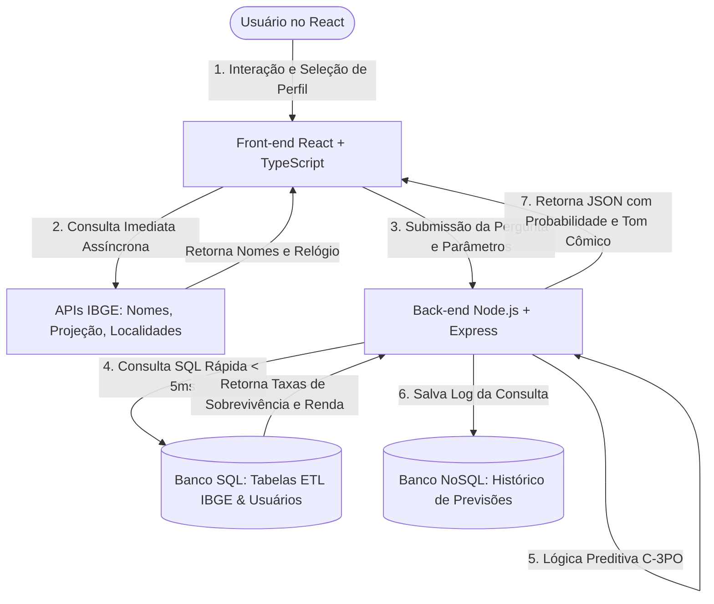

# Especificação Técnica - Vidente.db

## Sumário
1. [Visão Geral do Projeto](#1-visão-geral-do-projeto)
2. [Justificativa e Objetivos](#2-justificativa-e-objetivos)
3. [Arquitetura do Sistema](#3-arquitetura-do-sistema)
4. [Requisitos do Sistema](#4-requisitos-do-sistema)
    - [Requisitos Funcionais (RF)](#requisitos-funcionais-rf)
    - [Requisitos Não Funcionais (RNF)](#requisitos-não-funcionais-rnf)
5. [Regras de Negócio](#5-regras-de-negócio)
6. [Modelagem de Dados (Persistência Poliglota)](#6-modelagem-de-dados-persistência-poliglota)
    - [Banco de Dados Relacional (SQL)](#banco-de-dados-relacional-sql)
    - [Banco de Dados Não Relacional (NoSQL)](#banco-de-dados-não-relacional-nosql)
7. [Tecnologias Utilizadas](#7-tecnologias-utilizadas)
8. [Fontes de Dados e Integração (Oráculo)](#8-fontes-de-dados-e-integração-oráculo)
    - [Visão Geral e Eixos](#81-visão-geral-e-eixos-do-sistema)
    - [Dossiê Completo: Ecossistema do IBGE](#82-dossiê-completo-o-ecossistema-do-ibge)
    - [As 17 APIs Oficiais do Serviço de Dados](#83-análise-das-17-apis-oficiais-do-ibge)
    - [O Universo Dentro da API SIDRA](#84-o-universo-oculto-dentro-da-api-sidra-agregados)
    - [Limitações Técnicas e LGPD](#85-o-que-não-podemos-fazer-limitações-técnicas-e-lgpd)
    - [Tabela de Endpoints e Exemplos Práticos](#86-tabela-de-endpoints-e-exemplos-reais)
    - [Arquitetura Ideal de Integração](#87-arquitetura-ideal-de-integração-para-o-videntedb)

---

## 1. Visão Geral do Projeto
O **Vidente.db** é um sistema web interativo com temática humorística voltada ao universo de tecnologia/nerd. O personagem central, inspirado no droide C-3PO de Star Wars, atua como um "oráculo" calculista e fatalista, fornecendo probabilidades dramáticas para perguntas feitas pelos usuários. O sistema será construído integrando conceitos de desenvolvimento web moderno (Web II) e persistência de dados híbrida (BD II).

## 2. Justificativa e Objetivos
Este projeto tem como principal objetivo acadêmico aplicar na prática os conceitos estudados nas disciplinas de **Web II** e **Banco de Dados II**.
A obrigatoriedade de adotar uma arquitetura de **persistência poliglota** justifica-se pela necessidade técnica de compreender e implementar múltiplos paradigmas de banco de dados (Relacional e Não Relacional) dentro do mesmo ecossistema, utilizando a ferramenta mais adequada para cada tipo de carga de trabalho e modelagem.

## 3. Arquitetura do Sistema
O sistema adota o modelo Cliente-Servidor baseado em API REST:
- **Client-side (Front-end):** Interface desenvolvida em React.js utilizando **TypeScript** (Single Page Application). É a camada encarregada de coletar as perguntas do usuário, exibir as animações do "Oráculo" e renderizar de forma reativa os retornos do sistema.
- **Server-side (Back-end):** API estruturada em Node.js com Express utilizando **JavaScript**, atuando como o elo de lógica de negócio e interfaceamento com a camada de persistência.
- **Database Layer:** Camada dividida estrategicamente entre um Sistema de Gerenciamento de Banco de Dados Relacional (SGBD) e um banco de dados NoSQL Orientado a Documentos.

## 4. Requisitos do Sistema

### Requisitos Funcionais (RF)
*(Ações e comportamentos que o sistema deve obrigatoriamente executar)*
- **RF01:** O sistema deve permitir que um usuário crie uma conta fornecendo Nome, E-mail e Senha.
- **RF02:** O sistema deve permitir a autenticação do usuário.
- **RF03:** O usuário poderá enviar uma pergunta em formato de texto livre para o Oráculo.
- **RF04:** O sistema deverá processar a requisição e retornar uma probabilidade (%) calculada e uma mensagem de resposta baseada no estilo do personagem.
- **RF05:** O sistema deve registrar e salvar um histórico das interações (perguntas, previsões e datas).
- **RF06:** O sistema deve expor um *feed* (lista pública ou privada) com as consultas recentes feitas ao Oráculo.
- **RF07:** O sistema deve permitir login e cadastro simplificado utilizando contas do Google (OAuth2).

### Requisitos Não Funcionais (RNF)
*(Restrições técnicas, performance, usabilidade e qualidade)*
- **RNF01:** A interface de usuário deve ser construída exclusivamente com a biblioteca React.js e padronizada com **TypeScript**.
- **RNF02:** O backend deve ser uma API RESTful escrita em **JavaScript**, utilizando Node.js e Express.
- **RNF03:** O armazenamento de dados deve ser híbrido (Poliglota), integrando um banco de dados relacional e um não relacional simultaneamente.
- **RNF04:** O sistema deve manter as senhas dos usuários criptografadas no banco (utilizando *hashes* como o bcrypt).

## 5. Regras de Negócio
- **RN01:** Não será permitido o cadastro de dois usuários com o mesmo endereço de e-mail.
- **RN02:** Toda previsão retornada pelo oráculo deverá conter uma taxa de probabilidade gerada de forma lógica e arbitrária variando entre 0% e 100%.
- **RN03:** O "tom" da mensagem retornada ao usuário deverá variar dependendo da faixa da probabilidade (Ex: Se probabilidade < 15%, a mensagem deverá ser excessivamente dramática e pessimista).

## 6. Modelagem de Dados (Persistência Poliglota)

### Banco de Dados Relacional (SQL)
Responsável por dados altamente estruturados e relacionamentos estáveis (Ex: Dados administrativos).
- **Entidades Foco:** `Usuarios`
- **Por que SQL?** Porque entidades de usuários exigem um esquema rígido (colunas fixas: id, nome, email, senha), integridade referencial forte e propriedades ACID para garantir que não haja duplicação ou anomalias nos logins.

### Banco de Dados Não Relacional (NoSQL)
Responsável pelo registro de alto volume e esquema flexível (Ex: Feed e Histórico).
- **Coleções Foco:** `Previsoes` (contendo o id do usuário associado, a pergunta, a probabilidade calculada e as palavras do oráculo).
- **Por que NoSQL?** As previsões podem ser consideradas *documentos*. O esquema não precisa ser engessado, facilitando a adição de novos metadados (como "humor do oráculo" ou "tempo de resposta") no futuro sem quebrar tabelas existentes. E possibilita altíssima velocidade para a leitura do "feed" na página inicial.

## 7. Tecnologias Utilizadas
- **Front-end:** React.js, TypeScript, HTML5, CSS3.
- **Back-end:** Node.js, Express, JavaScript.
- **Bancos de Dados:** PostgreSQL ou MySQL (SQL) + MongoDB (NoSQL).
- **Outros:** Git e GitHub (Versionamento).

## 8. Fontes de Dados e Integração (Oráculo)

Para gerar previsões estatisticamente reais (exibidas com o tom dramático e pessimista do C-3PO), o sistema integrará bases públicas e dados abertos do Brasil através de uma arquitetura híbrida de consumo direto e **ETL (Extract, Transform, Load)**.

### 8.1. Visão Geral e Eixos do Sistema
1. **Saúde e Longevidade:** Tábuas de sobrevivência, expectativa de vida e histórico demográfico de mortalidade.
2. **Carreira, Trabalho e Renda:** Indicadores de ocupação, renda média por profissão e evasão estudantil.
3. **Comportamento e Sociedade:** Casamentos, divórcios, hábitos de consumo e acesso a tecnologia.
4. **Caos Aleatório (Fallback):** Respostas lúdicas para perguntas não determinísticas geradas por APIs utilitárias (`Agify.io`, `YesNo API`).

---

### 8.2. Dossiê Completo: O Ecossistema do IBGE
O Instituto Brasileiro de Geografia e Estatística disponibiliza o **Serviço de Dados do IBGE** (`servicodados.ibge.gov.br`), um catálogo público de APIs REST gratuitas, abertas, com resposta nativa em formato `JSON` e que **dispensam chave de autenticação ou cadastro prévio**.

---

### 8.3. Análise das 17 APIs Oficiais do IBGE

Abaixo estão detalhados todos os 17 serviços oficiais disponibilizados no catálogo de dados abertos do instituto:

1. **API de Agregados (SIDRA - `/api/v3/agregados`):**
   - *Finalidade:* Acesso ao banco do Sistema IBGE de Recuperação Automática. Centraliza dados tabulares de censos e pesquisas econômicas e sociais.
   - *Aplicação no C-3PO:* Cálculo de cruzamentos avançados de renda, desemprego e saúde.
2. **API de Nomes (`/api/v2/censos/nomes`):**
   - *Finalidade:* Estatísticas de frequência, popularidade histórica por década (desde 1930) e ranking por sexo e UF a partir do Censo Demográfico.
   - *Aplicação no C-3PO:* O oráculo analisa o nome do usuário e calcula a raridade dele na população galáctica brasileira.
3. **API de Projeções Populacionais (`/api/v1/projecoes`):**
   - *Finalidade:* Projeções matemáticas da população brasileira e estadual em tempo real, além do relógio de frequência (intervalo em segundos de nascimentos e mortes).
   - *Aplicação no C-3PO:* Renderização de relógio cósmico na tela: *"Desde que você abriu esta página, 3 cidadãos nasceram e 2 faleceram no Brasil"*.
4. **API de Localidades (`/api/v1/localidades`):**
   - *Finalidade:* Lista hierárquica oficial de divisões político-administrativas (Regiões, Estados, Mesorregiões, Microrregiões e Municípios com códigos IBGE).
   - *Aplicação no C-3PO:* Alimentação dos campos de formulário dinâmicos no front-end React.
5. **API de Malhas Geográficas (`/api/v3/malhas`):**
   - *Finalidade:* Extração de polígonos e limites territoriais nos formatos vetoriais `SVG`, `GeoJSON` e `TopoJSON`.
   - *Aplicação no C-3PO:* Exibição de mapa interativo no React, destacando o estado do usuário com efeitos de alerta.
6. **API de Países (`/api/v1/paises`):**
   - *Finalidade:* Indicadores sociais, demográficos, econômicos e ambientais consolidados de mais de 190 nações do mundo.
   - *Aplicação no C-3PO:* Comparações internacionais dramáticas: *"A sua probabilidade de sobrevivência seria 22% maior se residisse na Islândia, senhor!"*.
7. **API do CNAE (`/api/v2/cnae`):**
   - *Finalidade:* Classificação Nacional de Atividades Econômicas (Seções, Divisões, Grupos e Classes).
   - *Aplicação no C-3PO:* Classificação formal do setor de trabalho do usuário para cálculos de riscos ocupacionais.
8. **API de Notícias (`/api/v3/noticias`):**
   - *Finalidade:* Consulta aos releases, notícias institucionais e editorias publicadas pela agência IBGE.
   - *Aplicação no C-3PO:* Noticiário estelar ao vivo de dados do Brasil integrado ao feed do site.
9. **API de Calendário (`/api/v3/calendario`):**
   - *Finalidade:* Cronograma oficial de divulgação de índices (IPCA, PIB, PNAD).
   - *Aplicação no C-3PO:* Previsões de datas futuras onde novos dados trarão "más ou boas notícias".
10. **API de Pesquisas (`/api/v1/pesquisas`):**
    - *Finalidade:* Metadados, notas metodológicas e histórico de todas as operações estatísticas do instituto.
11. **API de Produtos (`/api/v1/produtos`):**
    - *Finalidade:* Catálogo de softwares, tabelas, dados vetoriais e publicações geradas pelo instituto.
12. **API de Publicações (`/api/v1/publicacoes`):**
    - *Finalidade:* Consulta bibliográfica e relatórios técnicos do IBGE em formato digital.
13. **API de Metadados (`/api/v1/metadados`):**
    - *Finalidade:* Dicionário oficial de conceitos, variáveis e classificações estatísticas.
14. **API de Banco de Dados Geodésicos - BDG (`/api/v1/bdg`):**
    - *Finalidade:* Estações geodésicas, marcos altimétricos e dados de nivelamento do território nacional.
15. **API ProGriD (`/api/v1/progrid`):**
    - *Finalidade:* Transformação técnica de coordenadas entre referenciais geodésicos (SAD69, Córrego Alegre, SIRGAS2000).
16. **API de Posicionamento por Ponto Preciso - PPP (`/api/v1/ppp`):**
    - *Finalidade:* Pós-processamento de dados GNSS para precisão centimétrica de receptores de satélite.
17. **API RBMC (`/api/v1/rbmc`):**
    - *Finalidade:* Rede Brasileira de Monitoramento Contínuo dos Sistemas GNSS (dados de rastreio de satélites).

*(Nota: Os serviços 14 a 17 são de natureza estritamente geodésica e cartográfica especializada, não sendo o foco principal de inferência probabilística do oráculo, mas compõem o catálogo completo oficial).*

---

### 8.4. O Universo Oculto Dentro da API SIDRA (Agregados)

A API de Agregados (`/api/v3/agregados`) é um repositório gigantesco que contém dezenas de pesquisas sociológicas e econômicas essenciais para o nosso gerador de probabilidades:

* **Estatísticas do Registro Civil:**
  * Dados anuais de casamentos civis, uniões e divórcios por faixas de idade dos cônjuges e estado.
  * *Uso no C-3PO:* Predição de riscos matrimoniais e probabilidade de divórcio em $N$ anos.
* **Pesquisa de Orçamentos Familiares (POF):**
  * Padrão de consumo das famílias: percentual de gastos com moradia, alimentação, remédios, entretenimento, eletrônicos e endividamento.
  * *Uso no C-3PO:* Cálculo da probabilidade de o usuário terminar o mês com dívidas ou gastar mais com delivery do que com investimentos.
* **Pesquisa Nacional de Saúde (PNS):**
  * Proporção de indivíduos com doenças crônicas, sedentarismo, obesidade, consumo de álcool/tabaco e diagnóstico de depressão por UF.
  * *Uso no C-3PO:* Inferência de riscos de saúde e hábitos com tom irônico de manutenção de droides.
* **PNAD Contínua (Pesquisa Nacional por Amostra de Domicílios Contínua):**
  * Séries temporais de taxa de desocupação (desemprego), informalidade e rendimento médio real domiciliar *per capita*.
  * *Uso no C-3PO:* Probabilidade de sucesso no mercado de trabalho e média de tempo para colocação profissional.
* **Censo Agropecuário:**
  * Informações de rebanhos (bovino, suíno, aves) e colheitas agrícolas.
  * *Uso no C-3PO:* Geração de dados de humor regional (ex: número de bovinos *versus* seres humanos por metro quadrado na região do usuário).
* **Índices de Preços ao Consumidor (IPCA / INPC):**
  * Acompanhamento oficial da inflação e perda do poder de compra no Brasil.

---

### 8.5. O que NÃO Podemos Fazer (Limitações Técnicas e LGPD)

1. **Apenas Operações de Leitura (`GET`):** Todas as APIs do IBGE são estritamente de consulta pública. Não é possível enviar cadastros ou modificar dados.
2. **Limite de Células no SIDRA (50.000 a 100.000 células):** Consultas muito amplas (ex: "todas as variáveis de todas as cidades de todos os anos") geram estouro de memória, truncamento ou erro de *HTTP 400/500*.
3. **Sem Garantia de SLA / Risco de Timeout (`HTTP 504`):** Os servidores federais sofrem picos de instabilidade. A dependência síncrona do IBGE em tempo de execução causaria lentidão inaceitável para o usuário final.
4. **Anonimização Estrita (LGPD e Lei do Sigilo Estatístico nº 5.534/1968):** O IBGE **nunca** disponibiliza dados nominais ou microdados individuais por API. A granularidade mínima é municipal ou por faixa amostral.
5. **Tábuas de Mortalidade Fora do SIDRA Dinâmico:** As Tábuas Completas de Mortalidade são divulgadas como relatórios de projeção anual (planilhas consolidadas), não como rota dinâmica no SIDRA, exigindo importação prévia (ETL).

---

### 8.6. Tabela de Endpoints e Exemplos Reais

| Finalidade | Método | Endpoint Oficial | Retorno Esperado |
| :--- | :---: | :--- | :--- |
| **Frequência de Nome** | `GET` | `https://servicodados.ibge.gov.br/api/v2/censos/nomes/{nome}` | Array JSON com décadas e total de ocorrências. |
| **Ranking Nacional de Nomes** | `GET` | `https://servicodados.ibge.gov.br/api/v2/censos/nomes/ranking` | JSON com os 20 nomes mais registrados no Brasil. |
| **Projeção Populacional** | `GET` | `https://servicodados.ibge.gov.br/api/v1/projecoes/populacao` | Estimativa atualizada ao segundo e taxas de nascimento/óbito. |
| **Lista de UFs (Estados)** | `GET` | `https://servicodados.ibge.gov.br/api/v1/localidades/estados` | Lista com `id`, `sigla` e `nome` das 27 UFs. |
| **Municípios de uma UF** | `GET` | `https://servicodados.ibge.gov.br/api/v1/localidades/estados/{UF}/municipios` | Lista de municípios do estado especificado. |
| **Malha Vetorial de um Estado** | `GET` | `https://servicodados.ibge.gov.br/api/v3/malhas/estados/{UF}?formato=application/vnd.geo+json` | Polígonos em GeoJSON para renderização de mapa. |
| **Indicadores de Países** | `GET` | `https://servicodados.ibge.gov.br/api/v1/paises/{pais}` | Indicadores econômicos e sociais do país solicitado. |
| **Consulta SIDRA (Exemplo)** | `GET` | `https://servicodados.ibge.gov.br/api/v3/agregados/{agregado}/periodos/{p}/variaveis/{v}?localidades={n}` | Matriz estruturada de dados agregados. |

---

### 8.7. Arquitetura Ideal de Integração para o Vidente.db

A persistência e a lógica do sistema serão organizadas em três camadas complementares para garantir velocidade e confiabilidade:

* **Consumo Imediato no Front-end (Client-Side):**
  * O React consome diretamente as APIs leves (`Localidades`, `Nomes` e `Projeções Populacionais`) para fornecer formulários dinâmicos e enriquecimento de tela sem sobrecarregar o back-end.
* **Camada de Carga Prévia (ETL no Banco SQL):**
  * Dados analíticos pesados (Tábua de Mortalidade, Renda da PNAD, Estatísticas do Registro Civil) são extraídos previamente, normalizados e indexados no banco relacional (MySQL/PostgreSQL).
  * O Node.js consulta o banco local com índices compostos `(uf, faixa_etaria, sexo)`, respondendo em menos de 5 milissegundos.
* **Camada de Auditoria e Flexibilidade (Banco NoSQL):**
  * Cada previsão gerada pelo C-3PO é persistida no MongoDB contendo o ID do usuário, a pergunta feita, os parâmetros demográficos utilizados e a resposta gerada com suas probabilidades.
